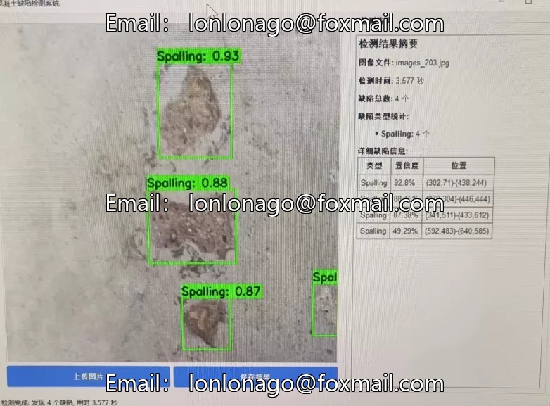
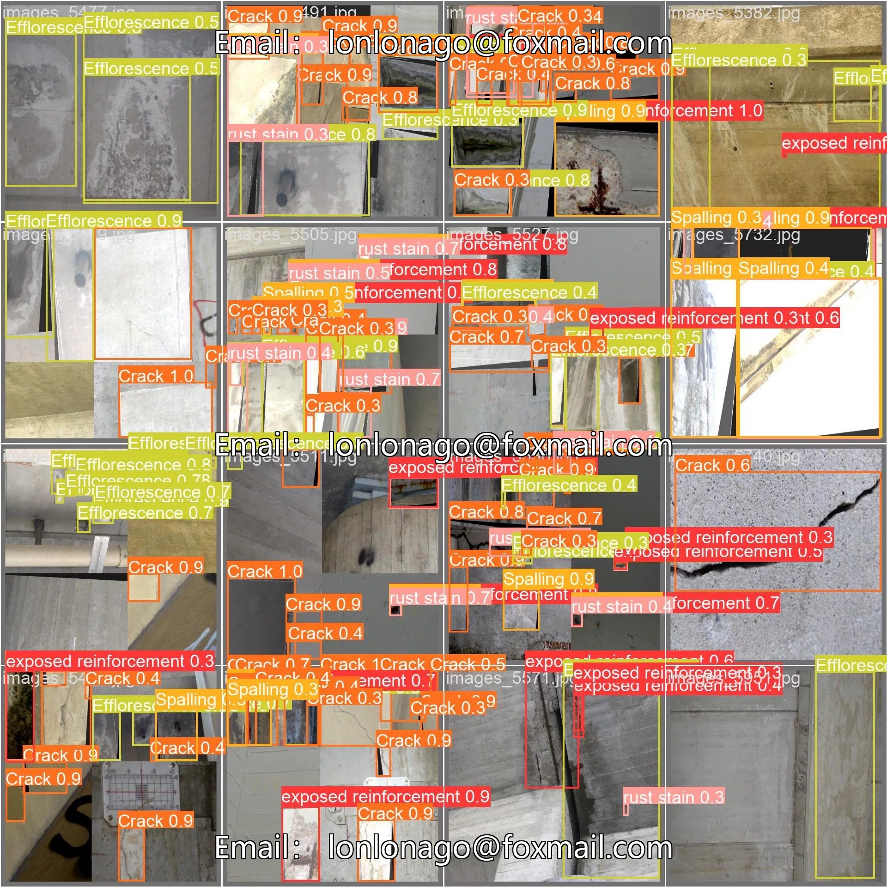
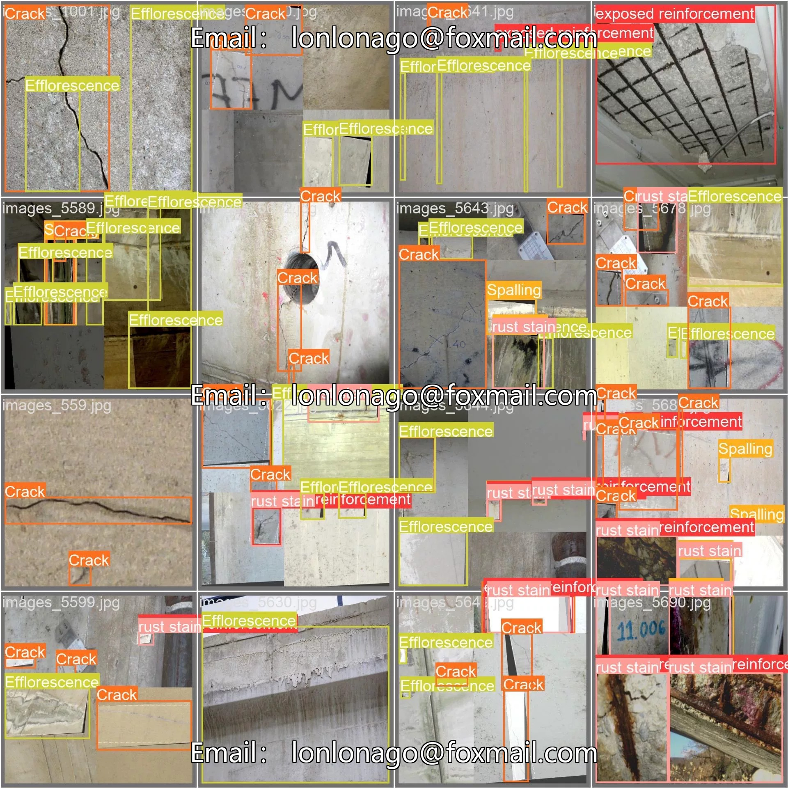
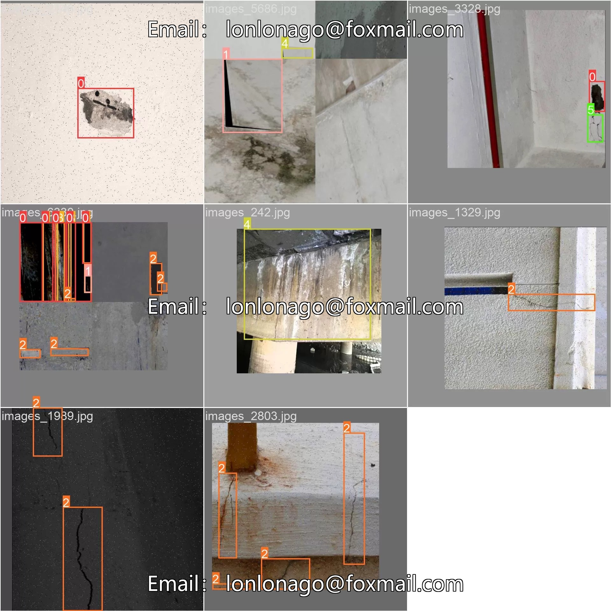
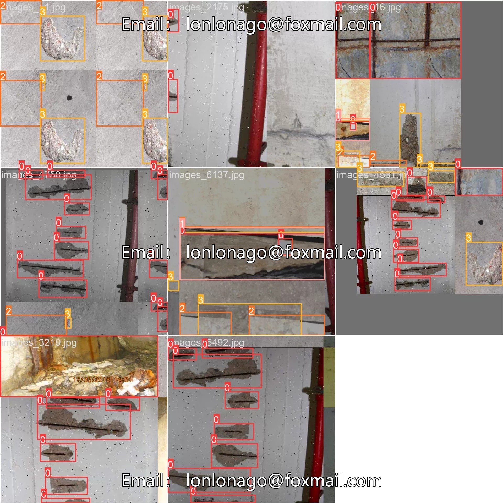
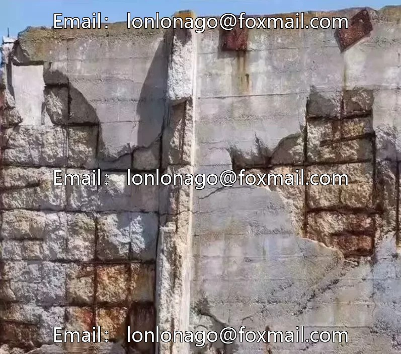

# Deep learning dataset for concrete exterior wall disease and crack detection, including peeling, water seepage, and cracks.

## Body

Deep Learning Concrete Surface Defects Detection Dataset for Cracks, including three types of defects: peeling, water seepage, and cracks, with a total of 5500 images. The annotations are clear and suitable for training target detection models such as YOLOv8.

The dataset has been divided into training set (approximately 4400 images) and validation set (approximately 1100 images), supporting model validation. The accompanying data configuration files, training scripts, and folder structure can be directly used.

Training 150 epochs, MPA reaches 0.84. The model trained based on YOLOv8s.pt has high recognition accuracy and is suitable for AI inspection, vehicle detection, fixed-mount video surveillance, digital twins, and other scenarios.

Virtual materials, once sold, are non-refundable.
Interested friends, click "I want" to proceed.

## Images

## Payment

Here is a pay link on Stripe ( https://buy.stripe.com/3cs8yP7sY87d0vu9AB ). Please contact me lonlonago@foxmail.com after funding $89, and I will send you a complete data files , thank you!

